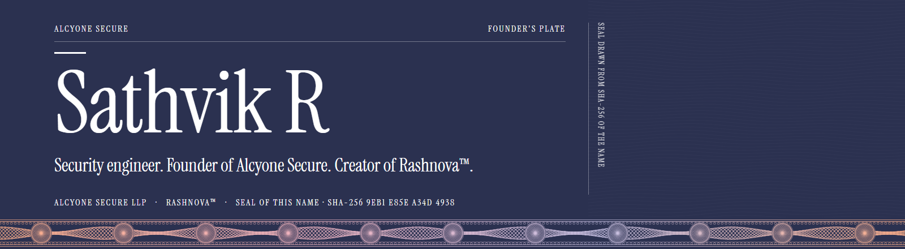

  

# Sathvik R

**I'm Sathvik R, a security engineer and the founder of Alcyone Secure, based in Bengaluru, India. I built Rashnova™ alone, end to end: the first repair mode for laptops that proves what was done, not just hides your data. I'm building the layer security never had, evidence of what actually happened on a computer, and I speak about it so more people see the gap.**

It started with my own months-long investigation into the trade in stolen private photos. One source turned out to be repair counters. Phones had modes that only hide your data, such as Samsung Maintenance Mode and Pixel Repair Mode. Laptops had nothing, and nothing could prove what was opened, copied or plugged in while a laptop was away. So I built it.

## What I'm best at

- **Building security products end to end.** C#/.NET, Python, C/C++, TypeScript and Linux, with a focus on Windows system-level security and cryptography in practice: tamper-evident hash chains, encryption and post-quantum signatures.
- **Offensive security.** Penetration testing on client engagements across web, network and Active Directory. Completed the Hack The Box CPTS learning path. I design and build offensive security hardware for authorised assessments, including a portable Raspberry Pi wireless research device with an e-ink display.
- **Data protection law.** DPDP Act 2023 compliance assessments for funded startups, backed by a 100% score in Data Protection Law from the Asian School of Cyber Laws.
- **Speaking and awareness.** Talks, awareness sessions and workshops on how everyday devices leak private data.

## What I've built

From one Windows app, I have grown Rashnova into a product line:

- **Rashnova for Windows.** Shipping, version 1.3. Free forever, no account, works offline. Repair Mode, Handover Mode, and Rashnova Proof: offline proof that a file existed exactly as it is by a certain time, signed twice, once with post-quantum cryptography.
- **Rashnova for Organisations.** In development. Independent evidence for companies: what their security tools saw, whether protection was switched off or bypassed, what happened after an alert, and one trusted place to answer regulators, auditors and boards.
- **Rashnova Lite.** Built and in security testing. The same idea, for phones.

I fund Alcyone Secure myself through my DPDP compliance work, not with investors' money and not with user data. I lead product, research and engineering, working with a co-lead and a team across engineering, research, testing and design. Rashnova's public documentation is published in 9 languages.

## Highlights

- **Speaker, "Beyond Protection: Why Cybersecurity Needs Proof" (September 2026).** Invited by SecurityBoat to speak at their community meetup, held at CloudSEK's Bengaluru office. 97 registered.
- **Winner, cybersecurity track, Recursive V2 international hackathon.** 2,000+ applicants, top 10 finalists, winners chosen by the CloudSEK team. Built in 24 hours, team of two.
- **Original research.** The investigation behind Rashnova, published as case files. [Read the case files](https://alcyonesecure.com/risks)
- **Founded Alcyone Secure in 2025,** now Alcyone Secure LLP.
- **Lead a university cybersecurity club.** CTF challenge design, workshops for 100+ participants, mentoring in penetration testing and secure coding.

## Credentials

- Certificate in Data Protection Law, Asian School of Cyber Laws, scored 100% ([verify](https://www.asianlaws.org/verify.php))
- Securiti PrivacyOps Certified · Qualys VMDR Specialist · Cisco Ethical Hacker · Fortinet Cybersecurity Fundamentals

## Elsewhere

[alcyonesecure.com](https://alcyonesecure.com) · [alcyonesecure.in](https://alcyonesecure.in) · [LinkedIn](https://www.linkedin.com/in/sathvik-r-dev) · [Rashnova docs, in 9 languages](https://github.com/sathvik-zoldyck/blackbox-docs)

Side projects: [Soundpost](https://github.com/sathvik-zoldyck/Soundpost), [CipherSuite](https://github.com/sathvik-zoldyck/ciphersuite), [Risk Awareness Platform](https://github.com/sathvik-zoldyck/risk-awareness-platform).

Outside work: I speak eight languages (English, Hindi, Kannada, Telugu, Tulu, Urdu, Punjabi and Malayalam), trained four years in boxing and MMA, make digital art and 2D animation, and play poker for fun.
